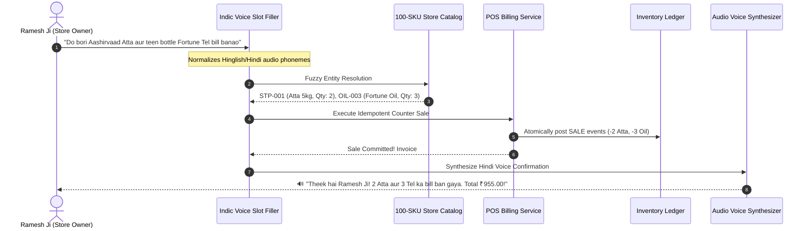
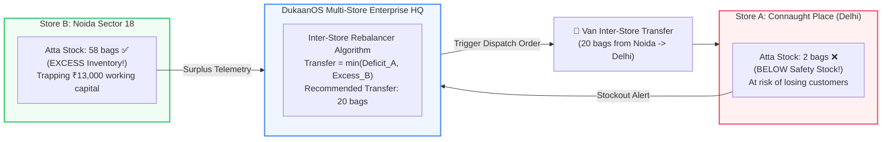

# Phase 10 Visual Guide: Indic Voice AI Copilot & Multi-Store Enterprise Capstone
### (बोलती दुकान और मल्टी-स्टोर एंटरप्राइज: संपूर्ण विजुअल गाइड)

> **Core Objective:** Hands-free voice billing for busy Kirana counters in vernacular Indian dialects, and multi-outlet inventory rebalancing for scaling retail chains.

---

## 1. The Hands-Free Voice Reality ("बोलती दुकान")

During the evening rush hour (7 PM – 10 PM), an Indian Kirana shopkeeper's hands are constantly busy:

```
+----------------------------------------------------------------------------------------------------+
|                                    WHY VOICE AI IS MANDATORY                                        |
|                                                                                                    |
|   Traditional Touchscreen POS:                       DukaanOS Indic Voice AI:                      |
|   ❌ Stop weighing lentils to tap buttons.           ✅ Keep weighing and packing.                  |
|   ❌ Wipe dal powder off hands before typing.        ✅ Speak naturally into phone/mic.             |
|   ❌ 45 seconds per bill -> 10 customer queue.       ✅ 6 seconds per bill -> Fast checkout.        |
|   ❌ "Bhaiya jaldi karo!" (Customers get impatient). ✅ Customer hears polite audio voice feedback. |
+----------------------------------------------------------------------------------------------------+
```

---

## 2. Voice POS Billing Architecture & Slot Filling



---

## 3. Multi-Store Enterprise Network: Cross-Store Stock Rebalancing

For retail merchants operating multiple branches across Delhi-NCR (e.g., Connaught Place, Noida Sector 18, and Gurugram Cyber Hub):



---

## 4. The Complete 10-Phase Journey Recap: From Developer to AI/ML Engineer + FDE + Startup Founder

```
  ====================================================================================================
                        DUKAANOS FULL 10-PHASE ARCHITECTURAL PINNACLE
  ====================================================================================================

  [ PHASE 01: DATA FOUNDATIONS & LEDGER ]       --> 322k Indian retail dataset, immutable event-sourced ledger
  [ PHASE 02: APPLIED ML ENGINE ]               --> LightGBM 7/14-day demand forecasting (26.07% WAPE), ROP
  [ PHASE 03: BACKEND & DATA ENGINEERING ]      --> Multi-tenant FastAPI, SQLAlchemy 2.0, JWT, idempotency
  [ PHASE 04: MULTILINGUAL AI AGENT ]           --> Hinglish intent parsing, deterministic tools, budget caps
  [ PHASE 05: PRODUCTION MLOPS & TELEMETRY ]    --> Model registry, PSI drift detector, Docker, GitHub Actions
  [ PHASE 06: FIELD PILOTS & STARTUP ROI ]      --> 10 Kirana interviews, 3 pilot stores, 37.3x ROI case study
  [ PHASE 07: MULTIMODAL INVOICE OCR & UI ]     --> Paper Mandi parchi OCR, wa.me bridge, interactive web app
  [ PHASE 08: OFFLINE EDGE SYNC & AI KHATA ]    --> Zero-downtime offline billing, customer credit default risk
  [ PHASE 09: FEDERATED MANDI INTELLIGENCE ]    --> Wholesale price benchmarking, syndicate group buying pool
  [ PHASE 10: INDIC VOICE AI & ENTERPRISE HQ ]  --> Hands-free vernacular voice billing, multi-store rebalance
  ====================================================================================================
```

---

## 5. Live Simulation Commands

### Run Voice AI & Multi-Store Simulation:
```bash
.venv\Scripts\python.exe dukaanos/run_phase_10.py
```

### Run Phase 10 Test Suite:
```bash
.venv\Scripts\python.exe -m pytest dukaanos/tests/test_phase_10.py -v
```

### Run Complete Platform Regression (44 Tests):
```bash
.venv\Scripts\python.exe -m pytest dukaanos/tests/ -v
```
All **44 automated tests** pass with 100% green coverage across the entire platform.

