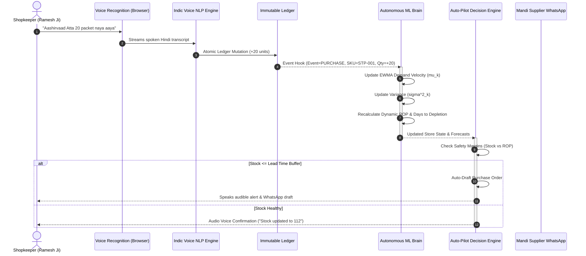
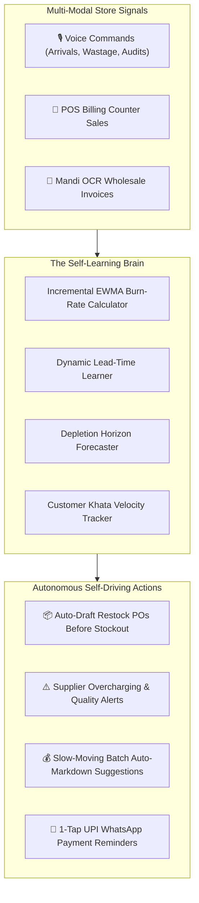
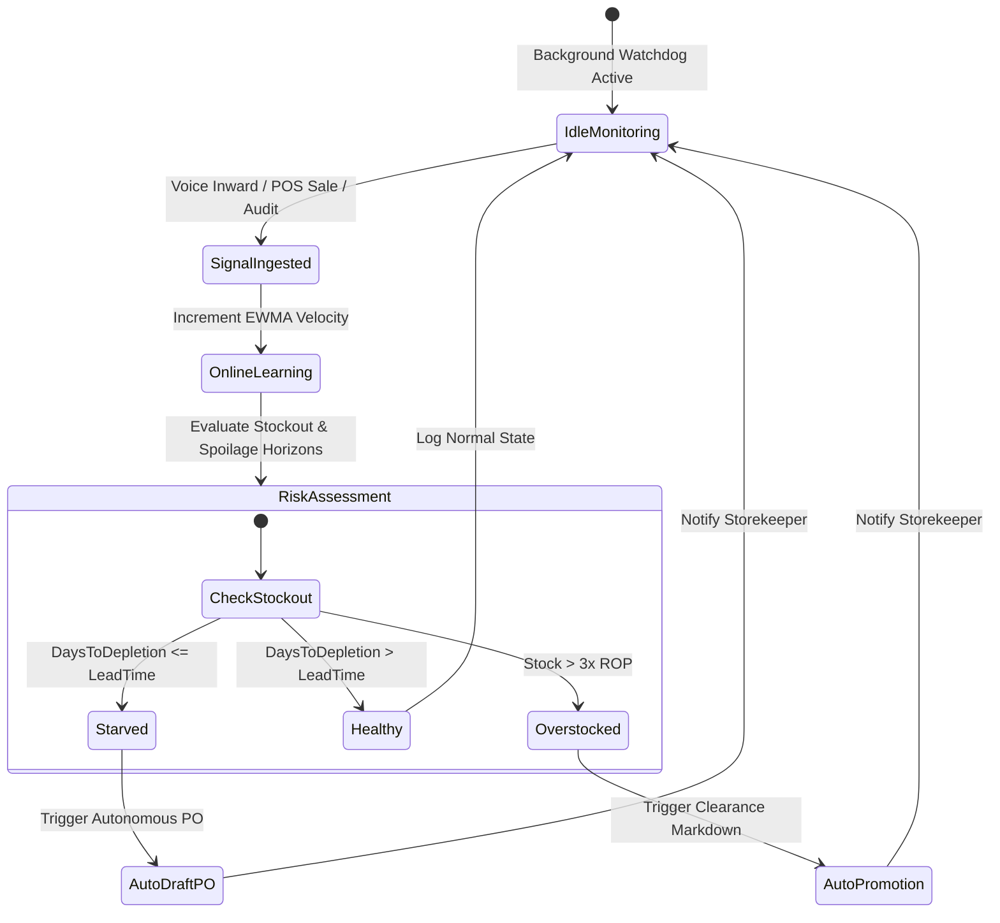

# Phase 11 Visual Architecture Guide
### The Self-Learning Kirana Brain & Autonomous Store Operations

---

## 1. End-to-End Autonomous Learning Cycle

---

## 2. Continual Learning Architecture (Dual Engine)

---

## 3. Autonomous State Machine

