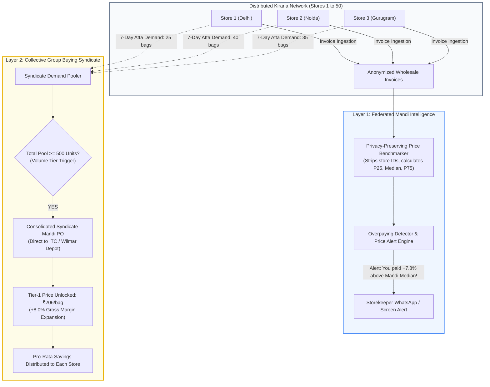

# Phase 9 Visual Guide: Federated Mandi Intelligence & Group Buying Syndicate
### (मंडी भाव और सामूहिक खरीद नेटवर्क: संपूर्ण विजुअल गाइड)

> **Core Objective:** Eliminate wholesale price discrimination by giving small Kiranas **real-time Mandi price transparency** and pooling their purchasing power into a **collective bulk buying syndicate** to unlock Tier-1 distributor discounts.

---

## 1. The Wholesale Price Discrimination Problem

In Indian wholesale Mandis, there is no printed price tag on wholesale sacks and cartons:

```
+----------------------------------------------------------------------------------------------------+
|                                WHOLESALE PRICE ASYMMETRY IN ACTION                                 |
|                                                                                                    |
|    🏪 Store A (Large Kirana)          🏪 Store B (New Kirana)            🏪 Store C (Distant Shop) |
|    "Bhaiya 100 bag Atta do"          "Bhaiya 15 bag Atta do"            "Bhaiya 20 bag Atta do"    |
|    Rate Quoted: ₹212 / bag           Rate Quoted: ₹228 / bag            Rate Quoted: ₹235 / bag    |
|                                                                                                    |
|    DISADVANTAGE: Store C pays ₹23 MORE per bag (+10.8% cost penalty) for the EXACT SAME Atta!      |
|    BECAUSE: Store C has no visibility into what Store A paid, and lacks individual buying volume.  |
+----------------------------------------------------------------------------------------------------+
```

---

## 2. Visual Architecture: How Phase 9 Changes the Game



---

## 3. Real-Life Kirana Case Example: The Narela Mandi Syndicate

### Scenario: 5 Local Kirana Stores Purchasing Edible Oil & Atta

| Store Name | Item | Individual Order | Quoted Standard Rate | Syndicate Rate (Group Buy) | Savings Per Store |
| :--- | :--- | :---: | :---: | :---: | :---: |
| **Shree Ganesh Kirana** | Aashirvaad Atta 5kg | 35 bags | ₹225.00 | **₹208.00** | **₹595.00** |
| **MahaLaxmi Provision** | Aashirvaad Atta 5kg | 40 bags | ₹228.00 | **₹208.00** | **₹800.00** |
| **Balaji Daily Mart** | Aashirvaad Atta 5kg | 50 bags | ₹226.00 | **₹208.00** | **₹900.00** |
| **Gupta Brothers** | Fortune Sunflower Oil 1L | 40 bottles | ₹142.00 | **₹131.00** | **₹440.00** |
| **Krishna Super Store** | Fortune Sunflower Oil 1L | 60 bottles | ₹140.00 | **₹131.00** | **₹540.00** |
| **TOTAL SYNDICATE PO** | **Atta (125 bags) + Oil (100 btls)** | **225 units** | **₹48,845.00** | **₹45,570.00** | **₹3,275.00 Saved in 1 Order!** |

> 💡 **Startup Flywheel:** Every new store that joins DukaanOS increases the syndicate's total buying volume, driving down wholesale prices for *all* member stores. This creates an **impenetrable local network effect**.

---

## 4. The Mandi Overpaying Alert Experience

When a shopkeeper uploads or enters an invoice, DukaanOS compares their purchase price against the local 14-day Mandi rolling median:

```
┌────────────────────────────────────────────────────────────────────────┐
│ ⚠️ DUKAANOS MANDI PRICE AUDIT ALERT                                   │
├────────────────────────────────────────────────────────────────────────┤
│ Item: Fortune Sunlite Refined Sunflower Oil 1L                         │
│ Your Invoice Rate : ₹142.00 / bottle                                   │
│ Mandi Cluster     : Delhi-NCR North (14 stores sampled)                │
│ Mandi Median Rate : ₹134.00 / bottle                                   │
│ Price Difference  : +₹8.00 (+6.0% OVERPAYING)                          │
├────────────────────────────────────────────────────────────────────────┤
│ 💡 Recommended Negotiation Talking Point:                             │
│ "Bhaiya, Narela mandi me 14 dukaane Fortune Sunlite ₹134 me utha      │
│  rahi hain. Aap humse ₹142 kyu le rahe ho? ₹134 ka rate lagao!"        │
│                                                                        │
│ [Join Next Group Buying Syndicate]   [Export Benchmark Proof]          │
└────────────────────────────────────────────────────────────────────────┘
```

---

## 5. Algorithmic Formulations

### 1. Price Gap Index ($\Delta P$)
$$\Delta P = \frac{P_{\text{store}} - P_{\text{mandi\_median}}}{P_{\text{mandi\_median}}} \times 100\%$$
- **$\Delta P \le +2.0\%$:** Fair competitive price.
- **$+2.0\% < \Delta P \le +5.0\%$:** Moderately elevated rate.
- **$\Delta P > +5.0\%$:** Price gouging alert triggered.

### 2. Syndicate Buying Allocation Formula
For each participating store $s \in S$:
$$\text{Allocation Share}_s = \frac{Q_s}{\sum_{i \in S} Q_i}$$
$$\text{Cost Savings}_s = Q_s \times (P_{\text{standard}, s} - P_{\text{syndicate\_bulk}})$$
$$\sum_{s \in S} \text{Cost Savings}_s = \text{Total Syndicate Wholesale Discount}$$
Ensures 100% mathematical conservation: zero hidden leakage.

